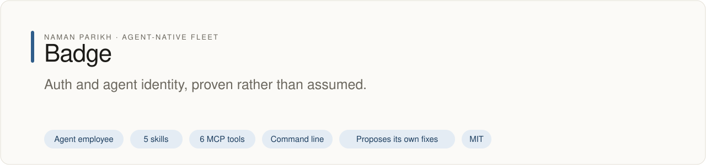

# badge

<!-- fleet:header:start -->
<p align="center"><picture><source media="(prefers-color-scheme: dark)" srcset="assets/banner-dark.svg"></picture></p>

<p align="center">
<a href="https://github.com/naman10parikh/badge/actions/workflows/ci.yml"></a>
<a href="https://github.com/naman10parikh/badge/releases"></a>
<a href="LICENSE"></a>
<a href="#use-it-from-any-coding-agent"></a>
<a href="https://x.com/naman10parikh"></a>
<a href="https://www.linkedin.com/in/naman-parikh1/"></a>
</p>

<p align="center"><a href="#quick-start">Quick start</a> · <a href="https://naman10parikh.github.io/badge/">Website</a> · <a href="docs/README.md">How it works</a> · <a href="AGENTS.md">AGENTS.md</a> · <a href="llms.txt">llms.txt</a> · <a href="skills/">Skills</a> · <a href="https://github.com/naman10parikh/badge/discussions">Discussions</a> · <a href="https://github.com/naman10parikh">All projects</a></p>

**Auth and agent identity, proven rather than assumed.**

Badge is an agent employee, a packaged specialist agent with its own skills, memory and tests. It owns one job: auth. Coding agents use it through its skills, its MCP server and its command line. A scheduled job runs its evals and proposes fixes. A person makes every change.

_Badge is part of an agent-native play for agent-native systems that can eventually be recursively self-improving and evolving, operated by agent employees._

<p align="center"></p>
<!-- fleet:header:end -->

badge is the auth employee for coding agents. It gets a real sign-in working in an app, picks an auth provider as a
decision with prices, audits OAuth and MCP setups, triages SAML/SSO failures and plans provider migrations. Its one
hard rule: an agent's authority is the strict intersection of the agent's and the user's permissions, never the union.

> Tagline: *Who you are, what you're allowed, proven — not assumed.* Powered by Energy.

<!-- fleet:use:start -->
## Use it from any coding agent

**Claude Code**: the plugin brings the skills, sub-agents, hooks and MCP server.

```
/plugin marketplace add naman10parikh/badge
/plugin install badge@badge
```

<details><summary>Its MCP server, Codex, Cursor, Gemini CLI, one skill and the command line</summary>

**Its MCP server**, in any MCP client:

```bash
claude mcp add --transport stdio badge -- npx -y -p github:naman10parikh/badge badge-mcp
codex mcp add badge -- npx -y -p github:naman10parikh/badge badge-mcp
```

Cursor (`.cursor/mcp.json`), Gemini CLI (`.gemini/settings.json`) and most other clients take the same command as JSON:

```json
{
  "mcpServers": {
    "badge": {
      "command": "npx",
      "args": [
        "-y",
        "-p",
        "github:naman10parikh/badge",
        "badge-mcp"
      ]
    }
  }
}
```

**Gemini CLI**: the extension brings the context and the MCP server.

```bash
gemini extensions install https://github.com/naman10parikh/badge
```

**One skill** (5 in all, in [skills/](skills/)), in any agent that reads Agent Skills:

```bash
gemini skills install https://github.com/naman10parikh/badge --path skills/agent-auth-classifier
git clone --depth 1 https://github.com/naman10parikh/badge /tmp/badge && cp -r /tmp/badge/skills/agent-auth-classifier ~/.claude/skills/
```

**The command line:**

```bash
npx -y -p github:naman10parikh/badge badge --help
```

</details>

Codex, Cursor, OpenCode, GitHub Copilot and other agents read [AGENTS.md](AGENTS.md); Claude Code reads [CLAUDE.md](CLAUDE.md) and Gemini CLI reads [GEMINI.md](GEMINI.md), which import it. [llms.txt](llms.txt) maps every surface for agents that read first.
<!-- fleet:use:end -->

## Quick start

Run it straight from GitHub, with no clone:

```bash
npx -y -p github:naman10parikh/badge badge --help
npx -y -p github:naman10parikh/badge badge classify "an agent needs to call my MCP server" --json
```

From a clone (Node 20 or later):

```bash
pnpm install
pnpm build
node bin/badge classify "an agent needs to call my MCP server" --json
node bin/badge advise --use-case enterprise --mau 100000 --json
pnpm test          # 87 tests
pnpm run eval      # 14 golden tasks and a 51-row labelled classification set
```

`classify` answers with the plane, the problem class (P1 here), the default tool (Stytch Connected Apps) and the
reason. A small local cockpit shows the same answers to a person: `node cockpit/server.mjs`, then open
http://localhost:7788. Agents use the CLI and the MCP server.

## How it works

Every command takes `--json`, and the same verbs are MCP tools on the `badge-mcp` server (stdio).

| Command | MCP tool | What it does |
| --- | --- | --- |
| `badge init --provider clerk` | | Writes a working sign-in to protected-route flow into a Next.js app. Clerk by default; BetterAuth, WorkOS and Stytch also work. |
| `badge classify "<task>"` | `badge_classify` | Places the plane (human sign-in or agent and MCP auth) and classifies an agent-auth task as P1, P2, P3 or P4 before any tool is picked. This is badge's core verb. |
| `badge advise --use-case enterprise --mau 100000` | `badge_advise` | Returns a provider decision with price breakpoints and the enterprise checklist, not a feature table. |
| `badge audit <path> --mcp` | `badge_audit` | Runs the pitfall checklist: PKCE method, RFC 8707 audience binding, account-linking gate, rotation atomicity, exact redirects, `alg=none`. |
| `badge saml-triage "<symptom>"` | `badge_saml_triage` | Runs the 7-step SAML/SSO triage runbook. |
| `badge migrate --from clerk --to betterauth` | `badge_migrate` | Plans a dual-validation window and names the four casualties: sessions, SSO connections, social links and custom claims. |
| `badge mcp-check <url>` | `badge_mcp_check` | Walks an MCP server's OAuth discovery (PRM, ASM, DCR or CIMD, authorize, token, tools/list) and reports spec gaps. |
| `badge runs` | | Summarises the run log, `logs/runs.jsonl`. |

The commands are thin. The asset is the brain in [`brain/`](brain/): judgment built from 16 named incidents, 35 taste
stances and version-pinned CVEs, searched with BM25 (`bash scripts/memory-search.sh "<query>"`). Its spec target is
MCP 2025-11-25, with CIMD preferred over DCR. badge does not do payments (that is penny), the login-box UI (pixel), the
users-table schema (acorn) or deploy and CI (rocket).

Around the brain sit the parts of a full harness: a persona in [`identity/`](identity/), five skills, the CLI, an
auth-lint hook that blocks unsafe auth code before it is written, two sub-agents (a provider auditor and a migration
planner), the MCP server, a task router, an eval pyramid, a run log, an E2B sandbox for the acceptance test (the CI
runner is the fallback), and a daily self-improvement loop. Agents start at [AGENTS.md](AGENTS.md); the machine map is
[llms.txt](llms.txt) and the A2A agent card is [`.well-known/agent.json`](.well-known/agent.json).

<!-- fleet:anatomy:start -->
## What it is made of

Every project in this fleet is graded on the same 11 harness components and on self-improvement. Each mark is backed by a file you can open.

| Component | Grade | Where |
| --- | --- | --- |
| Identity | ✅ | identity/SOUL.md:3 |
| Memory | ✅ | memory/MEMORY.md:1 + scripts/memory-search.sh:1 |
| Skills | ✅ | skills/agent-auth-classifier/SKILL.md:1 |
| Tools/CLIs | ✅ | bin/badge:1 |
| Hooks | ✅ | .claude/settings.json:4 + hooks/hooks.json:4 |
| Sub-agents | ✅ | .claude/agents/badge-provider-auditor.md:1 |
| MCPs | ✅ | bin/badge-mcp:1 + src/mcp/server.ts:30 |
| Dispatch | ✅ | src/dispatch/route.ts:197 + .github/workflows/rsi.yml:12 |
| Evals | ✅ | eval/run.mjs:1 + .github/workflows/ci.yml:64 |
| Observability | ✅ | src/obs/runs.ts:39 |
| Sandbox/Infra | ✅ | sandbox/run-in-sandbox.mjs:42 |
| Self-improvement | ✅ | dsip.json:1 + .github/workflows/rsi.yml:39 |

✅ real and tested · 🟡 partial, with the reason in the row · ❌ absent
<!-- fleet:anatomy:end -->

<!-- fleet:footer:start -->
## How it improves itself

It carries its own evals and a self-improvement contract, [`dsip.json`](dsip.json), which says what it may change and how a change is judged. A scheduled job runs its evals and proposes fixes. A person makes every change. Lessons it learns are kept as rules in its memory files.

## Part of a fleet

One of the projects by [Naman Parikh](https://github.com/naman10parikh). Each owns one part of an agent's harness, or of the product around an agent, and all of them follow one standard.

| Related project | What it owns |
| --- | --- |
| [AgentDial](https://github.com/naman10parikh/agentdial) | Identity |
| [WikiMem](https://github.com/naman10parikh/wikimem) | Memory |
| [Skillsmith](https://github.com/naman10parikh/skillsmith) | Skills |
| [Agent Booster](https://github.com/naman10parikh/agent-booster) | Tools / CLIs |
| [Hooksmith](https://github.com/naman10parikh/hooksmith) | Hooks |
| [AgentCast](https://github.com/naman10parikh/agentcast) | Sub-agents |
| [Plugsmith](https://github.com/naman10parikh/plugsmith) | Plugins |
| [Armory](https://github.com/naman10parikh/armory) | MCPs and the component registry |
| [AgentGrid](https://github.com/naman10parikh/agentgrid) | Dispatch |
| [AgentSwarm](https://github.com/naman10parikh/agentswarm) | Dispatch |
| [AgentBench](https://github.com/naman10parikh/agentbench) | Evals |
| [AgentMoney](https://github.com/naman10parikh/agentmoney) | Observability |
| [Sandforge](https://github.com/naman10parikh/sandforge) | Sandbox / Infra |
| [Claude Harness](https://github.com/naman10parikh/claude-harness) | The whole harness, as a template |

## Community

Questions and ideas go to [Discussions](https://github.com/naman10parikh/badge/discussions); bugs go to [issues](https://github.com/naman10parikh/badge/issues/new/choose). Follow the work on [X](https://x.com/naman10parikh) and [LinkedIn](https://www.linkedin.com/in/naman-parikh1/).

## Contributing and security

Read [CONTRIBUTING.md](CONTRIBUTING.md). AI-assisted pull requests are welcome. Report a vulnerability privately, as [SECURITY.md](SECURITY.md) explains.

## Star history

If it is useful to you, a star helps other people find it.

<a href="https://star-history.com/#naman10parikh/badge&Date"><picture><source media="(prefers-color-scheme: dark)" srcset="https://api.star-history.com/svg?repos=naman10parikh/badge&type=Date&theme=dark"></picture></a>

## Contributors

<a href="https://github.com/naman10parikh/badge/graphs/contributors"></a>
<!-- fleet:footer:end -->

## License

MIT. See [LICENSE](LICENSE).
