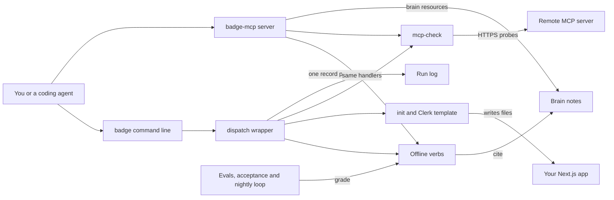

# How Badge works

Badge is an auth helper for developers and coding agents.
Auth covers two questions: who a user or agent is, and what they may do.
Badge adds Clerk sign-in to a Next.js app, recommends an auth provider for a use case, and audits OAuth and MCP settings for known mistakes.
OAuth is the standard way one app gets limited access to another on a user's behalf.
Badge also sorts agent auth problems into four kinds, P1 to P4, and names a default tool for each.
Most commands are rules written as code and work offline.

## The parts



The command line is [bin/badge](../bin/badge), which loads [src/cli/index.ts](../src/cli/index.ts).
It uses the compiled copy in `dist/` when one exists, and otherwise runs the TypeScript source through tsx.
Every command runs through `dispatch` in [src/cli/dispatch.ts](../src/cli/dispatch.ts), which prints JSON or text and turns errors into a clean exit code.
`dispatch` also appends one record per command to `logs/runs.jsonl` through [src/obs/runs.ts](../src/obs/runs.ts).
The MCP server in [src/mcp/server.ts](../src/mcp/server.ts) offers six verbs as tools over standard input and output.
MCP, the Model Context Protocol, lets an agent call tools by name.

The verb handlers live in [src/cli/](../src/cli/).
`classify`, `advise`, `audit`, `saml-triage` and `migrate` need no network, and each answer cites note ids from [brain/](../brain/), such as KP-A2.
`init` in [src/cli/init.ts](../src/cli/init.ts) writes the files from [src/cli/templates/clerk.ts](../src/cli/templates/clerk.ts) into your app.
`mcp-check` in [src/cli/mcp-check.ts](../src/cli/mcp-check.ts) is the only verb that calls the network.
The evals in [eval/](../eval/), the browser test in [acceptance/](../acceptance/) and the loop in [workflows/rsi.workflow.js](../workflows/rsi.workflow.js) check these handlers.

## What happens when you run it

The main flow adds sign-in to an app: `badge init --provider clerk --target ./my-app`.

1. [bin/badge](../bin/badge) loads the command tree from [src/cli/index.ts](../src/cli/index.ts), which parses the flags with commander.
2. `dispatch` in [src/cli/dispatch.ts](../src/cli/dispatch.ts) starts a timer and runs `initProvider` from [src/cli/init.ts](../src/cli/init.ts).
3. `initProvider` checks the provider name. An unknown name raises a `BadgeError`, which exits non-zero with a clear message.
4. Only `clerk` writes files today. The `betterauth`, `workos` and `stytch` targets return notes and write nothing.
5. For Clerk, it reads `NEXT_PUBLIC_CLERK_PUBLISHABLE_KEY` and `CLERK_SECRET_KEY` from the environment. If they are missing, it writes placeholder test keys.
6. It writes six files from [src/cli/templates/clerk.ts](../src/cli/templates/clerk.ts): `middleware.ts`, four files under `app/`, and `.env.local`.
7. Each file goes to a temporary file first and is then renamed, so a crash never leaves half a file.
8. The middleware protects `/dashboard` explicitly, because Clerk's middleware protects nothing by default.
9. It pins `@clerk/nextjs` in the app's `package.json`, and creates a minimal one if none exists.
10. `dispatch` prints the result as text, or as JSON with `--json`. It then logs the command, its duration and its outcome.

In CI, [acceptance/run.mjs](../acceptance/run.mjs) repeats this flow three times on a fresh Next.js app.
Each time it runs the Playwright test in [acceptance/e2e/protected-route.spec.ts](../acceptance/e2e/protected-route.spec.ts).
That test checks that a signed-out visit to `/dashboard` goes to `/sign-in`, and that signing in reaches `/dashboard`.

## Extending it

- **A verb.** Write a handler in [src/cli/](../src/cli/) that returns `{ data, human }`, the `HandlerResult` type in [src/cli/dispatch.ts](../src/cli/dispatch.ts). Register it in [src/cli/index.ts](../src/cli/index.ts) inside a `dispatch` call. Add tests under [src/cli/__tests__/](../src/cli/__tests__/).
- **An MCP tool.** Add an entry to `TOOLS` in [src/mcp/server.ts](../src/mcp/server.ts) that calls the handler. Then update [src/mcp/__tests__/contract.test.ts](../src/mcp/__tests__/contract.test.ts), which expects six tools.
- **An audit rule.** Add a detector to `DETECTORS` in [src/cli/audit.ts](../src/cli/audit.ts), with a rule id from [brain/KNOWN-PITFALLS.md](../brain/KNOWN-PITFALLS.md). Add a fixture under [eval/fixtures/](../eval/fixtures/).
- **A skill.** Create `skills/<name>/SKILL.md` with `name` and `description` front matter, like [skills/saml-sso-triage/SKILL.md](../skills/saml-sso-triage/SKILL.md).
- **An eval.** Add a golden task file to [eval/golden/](../eval/golden/), like [eval/golden/G3.json](../eval/golden/G3.json). Each file names a grader, a verb, its arguments and its assertions. For the classifier, add rows to [eval/labeled-set.jsonl](../eval/labeled-set.jsonl).

Run these before you push:

```bash
pnpm install
pnpm build
pnpm test
pnpm eval
```

## Questions

**Does it need an API key or cost money?**
No key is needed for the offline verbs, `mcp-check` or the MCP server.
The acceptance test needs Clerk test keys and a test user in `CLERK_TEST_*` variables, and it fails loudly without them.
The optional sandbox run in [sandbox/run-in-sandbox.mjs](../sandbox/run-in-sandbox.mjs) needs `E2B_API_KEY`.
It only boots a billed microVM when you pass `--boot`.

**Does any data leave the machine?**
Only `mcp-check` makes network calls from the command line.
It sends one POST with an empty JSON body and two GET requests for discovery documents to the server you name.
It refuses plain HTTP except on localhost, and it blocks internal and cloud metadata addresses.
The cockpit in [cockpit/server.mjs](../cockpit/server.mjs) listens on 127.0.0.1 only, and run records stay on disk.

**How does it improve itself?**
[dsip.json](../dsip.json) declares the `agent` level, with a nightly loop and no self-grading.
[.github/workflows/rsi.yml](../.github/workflows/rsi.yml) runs [workflows/rsi.workflow.js](../workflows/rsi.workflow.js) every day at 09:17 UTC.
The loop downloads five public sources, such as the MCP spec changelog, and compares their hashes with the last run.
A change adds a note to [brain/ORG_MEMORY.md](../brain/ORG_MEMORY.md).
The loop then checks [brain/TOOL-MATRIX.md](../brain/TOOL-MATRIX.md) and reruns the evals as a gate.
CI saves the brain diff for a person to review, and the loop never commits. The model step that would rewrite notes is not built yet.

**How do I run its tests or evals?**
`pnpm test` runs the Vitest suites in `src/**/__tests__` and `eval/`.
After `pnpm build`, `pnpm eval` runs the 14 golden tasks and scores the classifier on 50 labelled tasks.
The run fails unless every required task passes and the F1 score, a standard accuracy measure, is at least 0.8.
`node eval/run.mjs --ci` runs only the tasks that block CI, and `pnpm acceptance` runs the browser test.

**What does it not do?**
It does not host sign-in or store sessions. Your auth provider does that.
It scaffolds only Clerk today.
`mcp-check` reads discovery documents only. It does not complete a real sign-in or list the server's tools.
The task router in [src/dispatch/route.ts](../src/dispatch/route.ts) maps free text to a verb, but no command calls it yet.
Prices in `advise` are a dated snapshot, and each answer says to re-check them.
